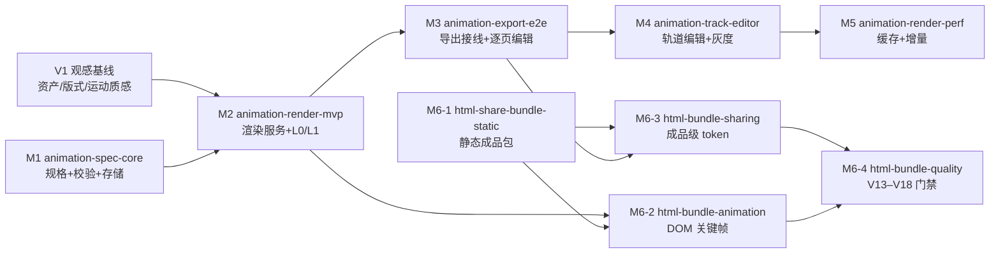

# 动画视频扩展 V1.0 — 交付路线图（OpenSpec 驱动）

> 来源：《动画视频扩展-设计方案-V1_0.md》（`E:/projects/项目设计文档/ppts/`）
> 本文件回答一个问题：**这份设计落到代码仓库后，按什么顺序、拆成哪些变更、每步的验收门禁是什么。**
> 不重复设计正文；只做排序、切分与依赖管理。

## 1. 当前进度

| 变更 | 对应里程碑 | 依赖 | 状态 |
|---|---|---|---|
| `animation-spec-core` | M1 规格与校验 | 无 | 第 1–5 组已完成（规格/校验/存储/迁移/REST 读写）；待 CI 跑 `-race` 后归档 |
| `html-share-bundle-static` ✅ 已归档 | M6-1 静态成品包 | 无 | 2026-10-28 归档（`openspec/changes/archive/2026-10-28-html-share-bundle-static`），能力规格落在 `openspec/specs/html-share-bundle`：打包器 + 播放器 + 导出接线 + 隐私模式本地生成（sidecar `export_bundle`）；体积基线 5min/28.55MB（音频占 95.2%） |
| `animation-visual-baseline` | §19 批次一（G2/G4/G5） | 无 | 已完成：令牌/10 版式/运动质感/度量 P1–P6/预览生成器；G1 只出契约，G6/G15 归 M2 |
| `animation-render-mvp` | M2 渲染 MVP | `animation-spec-core`、`animation-visual-baseline` | 编译链 + 服务契约 + 客户端已完成；模型/持久化已分包，渲染器不再链接数据库栈（17.10MB → 10.19MB）；真实 Remotion backend 与本机 30s 样片已落地（含嵌套元素按层出图 ADR-9）；服务端已具备容量上限（429 背压）、终态保留（TTL 回收，ADR-12）与重启清扫（ADR-13），剩镜像构建与盲评 |
| `animation-export-e2e` ✅ 已归档 | M3 导出接线 | `animation-render-mvp` | 2026-10-29 归档（`openspec/changes/archive/2026-10-29-animation-export-e2e`），能力规格落在 `openspec/specs/animation-export`（9 条 Requirement）：媒体层拼接与静态段 + 导出接线 + 逐页编辑器 + 单页预览 + 动画开关；4.1–4.5 人工验收全绿（1080p 动画版与静态版时长差 0ms、字幕带 PSNR 65.2/56.1dB、关开关与停服务都拿到静态版并给出 `animationDropped`）。验收中修掉三个「不报错但结果不对」的缺陷：预览预算写死 3s、分段键「页:段」与页内 id 错位、api/worker 两套动画开关判定 |

两者**无依赖关系，可并行开工**——这是设计 §14 / §20.9 的关键排序结论：先锁规格正确性，同时拿一个「双击可播」的可见成果。

## 2. 依赖图

> 批次一只落了"可编码的那一半"：G2 版式、G4 运动质感、G5 度量。G1 资产体系需要设计资源，本变更只出清单契约（`license` 必填、CC-BY 必须署名）；G6 交互预览与 G15 性能基准必须依附渲染器，随 M2 落地。**M2 的验收因此仍是"5 页样片与参考片并排盲评"**——基线只是把"拿什么评"写清楚了。

## 3. 变更序列（按建议开工顺序）

| # | 变更名 | 里程碑 | 前置 | 核心交付 | 合并门禁 |
|---|---|---|---|---|---|
| 1 | `animation-spec-core`（已建） | M1 | 无 | 模型、catalog、V1–V12、默认规格、Store、读写 API | `go test ./internal/animation/...`；依赖方向断言；`export.go` 零改动 |
| 2 | `html-share-bundle-static`（已建） | M6-1 | 无 | `html_bundle` 产物、manifest、底图转码、IIFE 播放器 | 解压双击可播；外链数 0；生成物与源码一致 |
| 3 | `animation-visual-baseline`（**已完成**） | §19 批次一 | 无（**优先于 M2**） | 设计令牌（栅格/字阶/色板）、10 个版式原型、运动质感档案（stagger/预备/回弹/停顿/速度分层/节拍）、度量 P1–P6、自包含预览页 | 令牌与原型自检 + 32 个用例 + 预览页逐区核对；「5 页样片盲评」移到 M2 验收 |
| 4 | `animation-render-mvp`（**已完成编译链 + 本机出片**） | M2 | #1、#3 | `CompiledTimeline` IR（无动效名，只留属性关键帧）、Spec→IR 编译器、渲染服务（`/v1/render` + `/healthz` + remotion/stub backend）、HTTP 客户端与降级信号 | IR/编译器/服务契约/客户端用例全绿 + 依赖方向断言；本机 Chrome 已出 5×6s=900 帧样片（容器/时长/帧数通过）；**剩余：镜像构建（4.5–4.8）、观感盲评（5.5）** |
| 5 | `animation-export-e2e`（**已建，第 1 组落地**） | M3 | #4 | `export.go` 动画分支与降级、逐页编辑器、导出选项 | 失败必降级为静态版；静态导出回归零失败 |
| 6 | `html-bundle-animation`（待建） | M6-2 | #2、#4 | DOM 关键帧编译（从 #4 的 IR 取数，不再解释规格）、catalog `targets`/`domFallback` | 两端同帧 SSIM ≥ 0.95 |
| 7 | `animation-track-editor`（待建） | M4 | #5 | 元素级轨道编辑、开关/配额、灰度 | 关闭开关后 0 副作用 |
| 8 | `html-bundle-sharing`（待建） | M6-3 | #2、#5 | 成品级 token、`/s/{token}` 与 `/p/{publicId}` 落点、密码/有效期/撤销 | 链接内容不随项目编辑变化 |
| 9 | `animation-render-perf`（待建） | M5 | #7 | 三级缓存、页级并行、EDL 拼接、增量重渲 | 二次渲染 ≤10s；命中率 ≥70%；P95 ≤120s |
| 10 | `html-bundle-quality`（待建） | M6-4 | #6、#8 | V13–V18 门禁、降级矩阵、埋点、字体子集/WebP/AAC | 三种降级可用；体积达标；埋点齐全 |
| 11 | `animation-vector-redraw`（条件触发） | P3 / L3 | 触发指标达成 | 解析器样式字段 + `vector-text` | 标题可打字机/逐字高亮 |

## 4. 门禁定义（每个变更都必须自带）

| 门禁 | 内容 |
|---|---|
| 构建 | Go：`go build ./... && go vet ./...`；前端（如涉及）：`npx tsc --noEmit` + `npm run build` |
| 测试 | `go test ./... -race`；新增包覆盖率不低于仓库同层平均水平 |
| 依赖纪律 | `go.mod` / `package.json` 无未经说明的新增依赖（设计附录 F 清单之外一律拒绝） |
| 回归 | 静态导出、讲稿、时间轴行为不变；涉及 `export.go` 的变更必须带表驱动测试 + 关闭开关下的等价用例 |
| 降级 | 任一新增能力故障都不得让用户拿不到视频（动画通道失败 → 静态版） |
| 文档 | 变更归档时同步 `openspec/specs/`，并把实际落地与设计偏差回写到方案文档 |

## 5. 未决决策（必须先定，再建对应变更）

| 编号 | 决策 | 影响变更 | 建议 |
|---|---|---|---|
| Q1 | 首版是否提供「全片预览」 | #5 `animation-export-e2e` | 先只做单页预览（成本可控），全片预览按配额开放 |
| Q2 | 免费层是否允许动画导出 | #7 `animation-track-editor` | 允许，但配额收紧（获客优先于短期成本） |
| Q3 | 竖屏比例是否进首版 | #4 `animation-render-mvp` | 不进；`RenderPlan` 已含宽高，留扩展位 |
| Q4 | 是否投入 Lottie 精修通道 | #3 `animation-visual-baseline` | 取决于是否有设计资源，先不做 |
| Q5 | HTML 成品默认形态（单文件/目录） | #2、#10 | 目录形态为默认，单文件作为「≤8MB 附赠」 |
| Q6 | 是否开放文本复制 | #8 `html-bundle-sharing` | 租户级开关，默认关闭 |

## 6. OpenSpec 工作流约定

- **一个里程碑一个变更**：变更名用能力语义（`animation-render-mvp`），不用「实现某某」。
- **能力路径稳定**：`animation-spec`、`html-share-bundle` 已建立；后续沿用同一路径追加 requirement，不新建近似能力。
- **归档动作**：变更任务全绿 → `openspec archive <name>` → 主 spec 吸收 delta；不手工编辑 `openspec/specs/`。
- **提交纪律**：一个变更 = 一个 commit（必要时按 PR1/PR2 拆分），提交信息带变更名与里程碑号。
