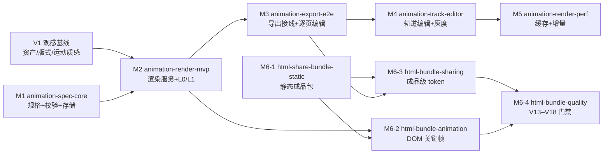

# 动画视频扩展 V1.0 — 交付路线图（OpenSpec 驱动）

> 来源：《动画视频扩展-设计方案-V1_0.md》（`E:/projects/项目设计文档/ppts/`）
> 本文件回答一个问题：**这份设计落到代码仓库后，按什么顺序、拆成哪些变更、每步的验收门禁是什么。**
> 不重复设计正文；只做排序、切分与依赖管理。

## 1. 当前进度

| 变更 | 对应里程碑 | 依赖 | 状态 |
|---|---|---|---|
| `animation-spec-core` ✅ 已归档 | M1 规格与校验 | 无 | 第 1–5 组已完成（规格/校验/存储/迁移/REST 读写）；2026-10-29 归档（`openspec/changes/archive/2026-10-29-animation-spec-core`），能力规格落在 `openspec/specs/animation-spec` |
| `html-share-bundle-static` ✅ 已归档 | M6-1 静态成品包 | 无 | 2026-10-28 归档（`openspec/changes/archive/2026-10-28-html-share-bundle-static`），能力规格落在 `openspec/specs/html-share-bundle`：打包器 + 播放器 + 导出接线 + 隐私模式本地生成（sidecar `export_bundle`）；体积基线 5min/28.55MB（音频占 95.2%） |
| `html-bundle-animation` ✅ 已归档 | M6-2 DOM 关键帧 | `html-share-bundle-static`、`animation-render-mvp` | 2026-10-29 归档（`openspec/changes/archive/2026-10-29-html-bundle-animation`）：清单 v2（底板 + 层图 + 转场 + clips 原样）、播放器按音频时钟回放 WAAPI、页间转场双面板、`shared/motion.ts` 成为两端唯一插值实现（解开渲染侧 2.9）；门禁 `scripts/review/dom-ssim.py` 逐页最差帧 0.99357–0.99818（阈值 0.95）；体积 669KB / 5 页 30 秒，20 页约 2.5MB。**未做**：catalog `targets`/`domFallback`（需产品决策） |
| `html-bundle-sharing` ✅ 已归档 | M6-3 成品分享 | `html-share-bundle-static` | 2026-10-29 归档（`openspec/changes/archive/2026-10-29-html-bundle-sharing`），能力规格落在 `openspec/specs/html-share-distribution`：新表 `artifact_share_links`（锚点 = 成品）、管理端建/列/撤、匿名 `/s/{token}` 入口与条目直出、口令 cookie、CSP、匿名审计。**门禁**「链接内容不随项目编辑变化」抓到真缺陷：`artifacts` 的 upsert 会原地改写 `object_key`，只绑 `artifact_id` 挡不住漂移 → 链接行改为快照 `object_key`/`content_hash`（design ADR-8）。**未做**：`/p/{publicId}` 公开广场接入（需产品先定「成品算不算作品」）、埋点 V18 |
| `html-bundle-quality` ✅ 已归档 | M6-4 质量门禁 | `html-bundle-animation`、`html-bundle-sharing` | 2026-10-30 归档（`openspec/changes/archive/2026-10-30-html-bundle-quality`），能力规格落在 `openspec/specs/html-share-quality`：V14 外链自检（打包时挂在唯一写出口上）、V15 体积构成与预算（3 MiB + 0.55 MiB/分钟）、V16 CDP 可播放性（真实 1x 播放到结尾）、V17 四条降级矩阵。**门禁抓到真实缺陷**：混音轨与逐段音频双份，音频占 80% → 只写混音轨，3.42 → 2.05 MiB（-40%）。**补的实现**：禁 JS 时 noscript 自带逐页图与讲稿、低内存不建动画层。**未做**：V18 埋点、字体子集/WebP/AAC、实测 fps 降级、移动端真机（V16/V17 已在 2026-10-31 进 CI，见 `animation-browser-gate-ci`） |
| `animation-settled-frame-gate` ✅ 已归档 | M6-4 补充（画面判据） | `html-share-quality` | 2026-10-31 建、同日归档（`openspec/changes/archive/2026-10-31-animation-settled-frame-gate`）：成品包终态帧与源页逐像素比（SSIM ≥0.995 / 平均差 ≤0.5 / 结构差异 ≤0.05%），参照物是页图、不需成片，因此进得了 CI。截图下沉到 `cdp.mjs` + `dom-shot.mjs`（按 seek 滑杆定位、回读落点）。**实测**：正例 0.99995；层框错 40px → 0.521%；底板 +10 → SSIM 0.960；尺寸不符/无浏览器 → 退出码 2。**顺带修**：播放器在 1920 下只画 492 宽（`#ppts-share-root` 让 `.ppts-share` 成了收缩的弹性项）、`app.js` 落后源码两个提交（V12/V13 的压暗修复没进成品包）| 
| `animation-browser-gate-ci` ✅ 已归档 | M6-4 补充（门禁进 CI） | `html-bundle-quality` | 2026-10-31 建、同日归档（`openspec/changes/archive/2026-10-31-animation-browser-gate-ci`）：把 V16/V17 从「只在本地跑得起来」搬到 CI。探针不再钉死镜像路径（`PPT_CHROME` → 平台路径 → 镜像），CDP 改用 Node 22 自带 WebSocket（旧 Node 退 `ws`），`file://` 改 `pathToFileURL`，加独立 `user-data-dir`；`bundle-gate.py --engine auto|native|docker`；`share-baseline -layers N` 产出带 clips 的图层（实测：无图层的包跑门禁红四项）。**本机实测**：21 条判据全 PASS（Windows + Chrome）、坏层图 → 仅 V16 资源项红、无图层 → V17 红四项、无浏览器 → 退出码 2。**当时未做**：`dom-ssim.py` / `still-check.py` 仍要渲染镜像（前者已由 `animation-cross-end-gate` 解决；后者本身只比两张 PNG，依赖镜像的是它的上游 `still.mjs`）|
| `animation-cross-end-gate` ✅ 已归档 | M6-4 补充（V13 搬出镜像） | `animation-settled-frame-gate`、`animation-browser-gate-ci` | 2026-10-31 建、同日归档（`openspec/changes/archive/2026-10-31-animation-cross-end-gate`）：V13 的截图半边换成 `dom-shot.mjs`（与 V13b 同一份实现），删掉 docker；`dom-shot --stage WxH` 去掉播放器 1280 的卡片上限并断言舞台等于目标尺寸；`make-fixture.mjs` 按 30fps 逐帧截包自己的 DOM 编码成逐页分段，于是「成片」在本地与 CI 都造得出来。**实测**：夹具正例逐页最差 0.99686 / 0.99675（连跑两次五位小数一致）、第 1 页整体左移 40px → 0.932 且只红该页、缺分段/画布不符 → 退出码 2；V13b 顺带吃到同一套尺寸处理（1920 页 0.99997，此前会被判「尺寸不符」）。**未做**：夹具不替代真实成片——它证明截图/抽帧/解码/阈值这条管线，不证明包与真实渲染一致。**CI 首跑**：`4b617f4` 的 #216 全绿，`share-browser` 里造夹具 34s、判定 3s（ubuntu 自带 ffmpeg，兜底分支未触发）|
| `animation-page-shots` ✅ 已完成（含 2x 素材） | §19 批次二（G3） | `animation-render-perf` | 2026-10-31 建：调研后发现「一页多镜」的硬缺口只有一处——`render.Page` 一张底图 + `service.go:630` 一页一段；同一页内的多次元素运动今天已支持（多图层 × 多 clip，clips 是页内相对时间）。因此不做完整 Scene 模型（那会同时解耦内容/时间/渲染/交互四个单元，波及片段缓存、清单游标校验、V13/V13b 取样），改做 `Page.Shots[]`：按时间切底图，层的时间基准不动。**三条已定**：120ms 叠化 / 每页 ≤4 镜 / 特写先接受糊图、2x 重渲后置。**已落地**：IR 校验、清单与打包（首镜复用页级图）、两端选图与叠化；实测播放器 2064ms 两张图同时在场、2400ms 纯特写，渲染端 2067ms 混合，与源图 meanDiff ≤0.005。**第 4 组已落地**：V13b 按末镜取参照物（无镜头 0.99994 / 特写 0.99994 / 特写图比舞台小时 0.99722）、V13 加切点取样（逐页最差 0.99646–0.99679）、新增 V18 切图判据（负例：播放器不认 shots → 切点后两条判据红）、夹具 `--shots`。**已做**：2x 素材（第 5 组，只影响清晰度）——导出对带 Crop 的页做 300 DPI 重渲、按原生分辨率裁切落盘（不重采样），边缘梯度能量≥95% 参照；渲染器缺失时优雅降级为 150 DPI 模糊路径 |
| `animation-visual-baseline` ✅ 已归档 | §19 批次一（G2/G4/G5） | 无 | 已完成：令牌/10 版式/运动质感/度量 P1–P6/预览生成器；G1 只出契约，G6/G15 归 M2 |
| `animation-render-mvp` ✅ 已归档 | M2 渲染 MVP | `animation-spec-core`、`animation-visual-baseline` | 2026-10-29 归档（`openspec/changes/archive/2026-10-29-animation-render-mvp`），能力规格落在 `openspec/specs/render-plan`（12 条 Requirement）。编译链 + 服务契约 + 客户端 + 镜像（`selftest ok … elapsed=9.42s`）+ 带真实文字的 5 页样片 + 30 页/5 分钟压测 + 单页降级（ADR-24：失败页换静态画面，不再整片失败）全部落地；6.6 真实 deck 已转出到 `animation-render-service-image`（PPTX→页图属上游 L0，渲染器只吃底图 + 元素矩形） |
| `animation-export-e2e` ✅ 已归档 | M3 导出接线 | `animation-render-mvp` | 2026-10-29 归档（`openspec/changes/archive/2026-10-29-animation-export-e2e`），能力规格落在 `openspec/specs/animation-export`（9 条 Requirement）：媒体层拼接与静态段 + 导出接线 + 逐页编辑器 + 单页预览 + 动画开关；4.1–4.5 人工验收全绿（1080p 动画版与静态版时长差 0ms、字幕带 PSNR 65.2/56.1dB、关开关与停服务都拿到静态版并给出 `animationDropped`）。验收中修掉三个「不报错但结果不对」的缺陷：预览预算写死 3s、分段键「页:段」与页内 id 错位、api/worker 两套动画开关判定 |
| `animation-track-editor` ✅ 已归档 | M4 轨道编辑与灰度 | `animation-export-e2e` | 2026-10-30 归档（`openspec/changes/archive/2026-10-30-animation-track-editor`），能力规格落在 `openspec/specs/animation-rollout`（6 条）、`animation-quota`（6 条）、`animation-track-editing`（5 条），共 17 条：①能力判定 `animation.AnimationPolicy.Resolve`（优先级 部署闸 > 租户显式 > 租户灰度 > 部署默认）、`animation-rollout` 6 条 Requirement、三处入口共用同一判定、`PPTS_ANIMATION_ROLLOUT`（默认 100，迁移期兼容）与 `SALT`；②动画渲染额度 `animation-quota` 6 条 Requirement：账期编进计量种类（`animation_minutes:YYYY-MM`，跨月是新行且仍单行原子预占）、受理预占/超限 429（带上限-已用-申请量-恢复时间）、按实际渲了动画的页结算（降级页不计费）、失败终态与取消释放（worker 新增 `OnFailed`）、`max_minutes` 未配置为不限量（ADR-7）；③元素级轨道时间轴 `animation-track-editing` 5 条 Requirement：拖动/微调**派生起点**的片段必须同时把 trigger 改写为 `atTime:<ms>`（只改 `startMs` 是「保存成功、成片不变」的假功能，ADR-9）、双端夹紧与页尾截断时长、撤销 24 步且还原时保留当前 `revision`、键盘 10/50ms、受 `capabilities.trackEditor` 控制（未开通只说一句说明，页时长未知时只读）。**未做**：批量套用（需页列表多选 + N 页写入的失败回滚语义，独立变更）、关键帧级 props 编辑、额度剩余量 UI 与自助提额 |
| `animation-render-perf` ✅ 已归档 | M5 渲染性能 | `animation-export-e2e` | 2026-10-30 归档（`openspec/changes/archive/2026-10-30-animation-render-perf`），能力规格落在 `openspec/specs/render-plan`（新增 7 条 Requirement）。片段缓存（键含前一页）+ 增量重渲 + 页级并行 + 性能门禁 `cmd/render-perf`。**实测**：二次渲染 2.4s（判据 ≤10s）、改一页命中 8/10=80%（≥70%，已是 `(n-2)/n` 上限）、30s 正片 P95 4 位 `4×1` 49.3s（≤120s）。**诚实结论**：默认 2 位是 133.9s，达不到 120s，必须显式开页级并行（推荐 `-concurrency 1 -page-concurrency 4`）；默认值留给 M4 按部署形态定。**未做**：S3/MinIO 适配器、缓存后台清理、底图级/成片级缓存（各有实测否决：86ms/页、2.0s） |
| `animation-render-service-image` ✅ 已归档 | M2 运行时与镜像契约 | `animation-render-mvp` | 2026-10-31 归档（`openspec/changes/archive/2026-10-31-animation-render-service-image`），能力规格落在 `openspec/specs/renderer-image`（11 条 Requirement）：转场与元素动画共用一次合成、浏览器/字体固定、去残影与嵌套图层、片段编码参数（纯 Go 解容器、接进自检）、渲染不可用不阻断导出、镜像自检。**本轮发现并修掉**：`plate_patch_noisy` 码不在任何输出里、SPS 解析把高档次当 Baseline、GOP 漏算片尾段、`gofmt -l` 被 CRLF 判成全员未格式化。**两处按边界收口**：5.9 部分重叠兄弟元素改为独立 REQUIREMENT（诊断必须产出、残影不记回归）；7.1 接受「`backend=none` 时静态版不含转场」，代价变成导出对话框里一句被断言守着的话（`web/animation-check.mjs` 31/31） |

两者**无依赖关系，可并行开工**——这是设计 §14 / §20.9 的关键排序结论：先锁规格正确性，同时拿一个「双击可播」的可见成果。

## 2. 依赖图

> 批次一只落了"可编码的那一半"：G2 版式、G4 运动质感、G5 度量。G1 资产体系需要设计资源，本变更只出清单契约（`license` 必填、CC-BY 必须署名）；G6 交互预览与 G15 性能基准必须依附渲染器，随 M2 落地。**M2 的验收因此仍是"5 页样片与参考片并排盲评"**——基线只是把"拿什么评"写清楚了。

## 3. 变更序列（按建议开工顺序）

| # | 变更名 | 里程碑 | 前置 | 核心交付 | 合并门禁 |
|---|---|---|---|---|---|
| 1 | `animation-spec-core`（已建） | M1 | 无 | 模型、catalog、V1–V12、默认规格、Store、读写 API | `go test ./internal/animation/...`；依赖方向断言；`export.go` 零改动 |
| 2 | `html-share-bundle-static`（已建） | M6-1 | 无 | `html_bundle` 产物、manifest、底图转码、IIFE 播放器 | 解压双击可播；外链数 0；生成物与源码一致 |
| 3 | `animation-visual-baseline`（**已完成**） | §19 批次一 | 无（**优先于 M2**） | 设计令牌（栅格/字阶/色板）、10 个版式原型、运动质感档案（stagger/预备/回弹/停顿/速度分层/节拍）、度量 P1–P6、自包含预览页 | 令牌与原型自检 + 32 个用例 + 预览页逐区核对；「5 页样片盲评」移到 M2 验收 |
| 4 | `animation-render-mvp`（**已完成编译链 + 本机出片**） | M2 | #1、#3 | `CompiledTimeline` IR（无动效名，只留属性关键帧）、Spec→IR 编译器、渲染服务（`/v1/render` + `/healthz` + remotion/stub backend）、HTTP 客户端与降级信号 | IR/编译器/服务契约/客户端用例全绿 + 依赖方向断言；本机 Chrome 已出 5×6s=900 帧样片（容器/时长/帧数通过）；**剩余：镜像构建（4.5–4.8）、观感盲评（5.5）** |
| 5 | `animation-export-e2e`（**已建，第 1 组落地**） | M3 | #4 | `export.go` 动画分支与降级、逐页编辑器、导出选项 | 失败必降级为静态版；静态导出回归零失败 |
| 6 | `html-bundle-animation`（**已归档**） | M6-2 | #2、#4 | 清单 v2（挖空底板 + 分层位图 + 转场 + clips 原样）、播放器按音频时钟回放 WAAPI、页间转场双面板、`shared/motion.ts` 两端共用 | 两端同帧 SSIM ≥ 0.95（实测逐页最差 0.99357）；无 WAAPI 与 reduced-motion 降级可用；静态包字节不变。catalog `targets`/`domFallback` 移出范围 |
| 7 | `animation-track-editor`（**已归档**） | M4 | #5 | 元素级轨道编辑、开关/配额、灰度 | 关闭开关后 0 副作用。**已落地**：①租户级能力判定（部署闸 > 租户显式 > 灰度 > 默认）、SHA-256 分桶、三处入口共用判定、`PPTS_ANIMATION_ROLLOUT`/`SALT`，用例覆盖显式 true 绕过 0% 灰度、显式 false 压过 100%、`policy_unreadable` fail closed、写 404/读 200；②渲染分钟额度：受理预占（30 并发上限 10 每单 4 → 只成功 2 单，不超卖）、超限 429 且不建任务、降级页不计费、整体退回静态结算 0、失败终态与取消释放、改上限下一次导出即生效；**迁移决策**：`max_minutes` 未配置为不限量（与 ADR-3 同一条理由：升级当天不给存量租户加硬停）；③元素级轨道时间轴：拖动/微调**派生起点**的片段改写 trigger 为 `atTime:<ms>`（用例守「只改 `startMs` 是保存成功、成片不变」）、双端夹紧、页尾截断时长、撤销 24 步保留 `revision`、键盘 10/50ms，`animation-check` 26/26。**未做**：批量套用（多选 + N 页写入回滚语义，独立变更）、关键帧级 props 编辑、额度剩余量 UI 与自助提额 |
| 8 | `html-bundle-sharing`（**已归档**） | M6-3 | #2、#5 | 新表 `artifact_share_links`（绑成品 + 快照 `object_key`）、管理端建/列/撤、匿名 `/s/{token}` 条目直出、口令 cookie、CSP、匿名审计 | 链接内容不随项目编辑变化（锚点用例：重新导出后旧 token 逐字节相同）；撤销即时生效；路径穿越全部 404。`/p/{publicId}` 公开广场接入移出范围（需产品决策） |
| 9 | `animation-render-perf`（**已归档**） | M5 | #7 | 片段缓存（键含前一页）、增量重渲（`--only-pages`）、页级并行（`--page-concurrency`）、性能门禁 `cmd/render-perf`；三级缓存中的底图层与成片层经实测否决 | 二次渲染 **2.4s**（判据 ≤10s）；改一页命中 **8/10=80%**（≥70%，`(n-2)/n` 上限）；30s 正片 P95 **49.3s**（≤120s，需 4 位）。逐页 SHA-256 四方一致（冷渲/关缓存/命中/增量）。**默认 2 位为 133.9s 不达标**，达标配置写进 `deploy/renderer/README.md` |
| 10 | `html-bundle-quality`（**已归档**） | M6-4 | #6、#8 | V14 外链自检、V15 体积构成与预算、V16 CDP 可播放性、V17 四条降级矩阵、禁 JS 可读、低内存降级、音频去重 | V13–V17 可一条命令跑完（`scripts/review/bundle-gate.py`）；实测 21 条判据全 PASS，2.05 MiB / 预算 3.28 MiB；反例删层图即红。V18 埋点与字体子集/WebP/AAC 移出范围（需产品与资产决策） |
| 11 | `animation-vector-redraw`（条件触发） | P3 / L3 | 触发指标达成 | 解析器样式字段 + `vector-text` | 标题可打字机/逐字高亮 |
| 12 | `animation-page-shots`（已完成，已归档） | §19 批次二 / G3 | #9（分段与缓存已定稿） | `render.Page.Shots[]`：页内按时间切底图，层的 clips 仍是页内相对；清单同步 + 校验；两端按镜头选图 | **已实测**：播放器 1500ms→整页、2064ms→两张图同时在场、2400ms→纯特写（与源图 meanDiff 0.002）；渲染端 1000/2067/2500ms 同构；有图层的页在特写镜头内层被隐藏且节点未重建。**门禁已就位**：V13b 换参照物、V13 加切点、V18 验切图与层未重建（CI 的 `share-browser` 作业里三条都跑，另有一条无镜头的包守回归）。**已做**：2x 素材——导出对带 Crop 的页做 300 DPI 重渲、原生分辨率裁切落盘（不重采样），边缘梯度能量≥95% 参照；渲染器缺失时优雅降级 |
| 13 | `animation-camera`（已完成，已归档） | §19 批次三（G7） | `animation-page-shots` | 镜头相机：镜头图局部归一化的平移/缩放关键帧（Ken Burns）。数据模型三处对齐（`animation`/`render`/`share`）+ IR 编译原样透传 + 浏览器/合成器共用插值纯函数（`shared/shots.ts` 与 `render.CameraTransform` 逐字节同语义）+ 播放器 `transform` 集成 + 校验门禁（scale≥1、**覆盖安全区间 [0.5/scale,1-0.5/scale]**——初版误用 [0,1] 后修正）+ Go/TS 单测 + `share-baseline` 相机样本。缺省行为不变（无相机=当前行为）；旧播放器忽略 `camera` 停在首镜（不升 schemaVersion）。**边界**：G8 跨场景元素延续（改 clip 时间基准，两个量级）仍独立成 change，**不在本变更 scope** | `go build/vet/test` + `tsc -b` + `vite build`（同步 `app.css`）+ 相机插值纯函数单测（Go/TS 同语义，含覆盖不变量定理）；`openspec validate` 通过 |
| 14 | `animation-cross-scene-continuation`（已完成，已归档） | §19 批次三（G8） | `animation-camera` | 跨场景元素延续：clip 标 `continues` 后溢出页尾的部分注入次页同 `element_id` 层。编译期**负起点平移求值**（次页段 `StartMs=-offset`、沿用完整 `[from,to]`），页缝处 cubic-bezier 缓动天然连续、无二次施加跳变；清单透传 `isContinuation`/`continuationOffsetMs`/`elementId`；播放器仅需对 `IsContinuation` 层跳过入场、负起点已是 `evaluateLayer` 标准字段故无需 clipTime 特判；旧播放器忽略新字段不崩不露白；`share-baseline -layers` 注入 `cont-N` 跨页延续夹具覆盖门禁。缺省行为不变（无 `continues` = 引入前）。**边界**：① 链式多页（>2 段）延续；② 渲染器端真正续播（v1 随共用 `evaluateLayer` 自动成立、由独立 change 补全）；③ 跨页元素静态位置/样式自动插值联动——三者均不在本变更 scope，各自独立成 change | `go build/vet/test` + `tsc -b` + `vite build`（同步 `app.css`）+ `npm run build:share` 重建 `app.js`（本次播放器源码无需改动、产物无漂移）+ Go/TS 续播单测（与 Go 同语义，覆盖页缝连续）；`openspec validate` 通过 |

| 15 | `animation-continuation-seam-gate`（已完成，已归档） | §19 批次三（G8 收尾） | `animation-cross-scene-continuation` | 页缝延续门禁 V19：延续夹具改显式 `-continuation`（默认注入会让 V13b 的末帧比对假红——延续元素在页尾本就是中途态；且旧条件 `pageMs>4000` 让 CI 用 `-page-secs 4` 时恰好跳过，实际从未覆盖）；补齐 clip 级 `elementId`（与 `render.Compiler` 输出同构）；新增 `scripts/review/seam-gate.mjs` 读成品包清单 + 共用 `shared/motion.ts`，断言链接字段 / 源段配对 / 页缝求值连续（Δ≤1e-6）/ 页缝处为中途态 / 非空跑（0 条延续段判红），接入 CI。**边界**：不做像素级页缝比对（「画得对不对」由 V13/V13b 各守），不改归档结论，仅在 G8 proposal 追加实施补记 | `go build/vet/test ./...` 全绿 + `npm run build`（tsc -b + vite build + 6 项检查）+ `build:share` 无漂移 + V19 正负向验证（无延续段=退出码 1；篡改起点/Props=退出码 1）；`openspec validate` 通过 |

| 16 | `animation-continuation-renderer-seam`（已完成，验证类，无 spec delta） | §19 批次三（G8 边界②） | `animation-cross-scene-continuation` | 渲染器端续播**验收**：`renderer/seam-check.mjs` 用渲染器同一帧网格（`framesForDuration`）在页缝两侧取帧，断言理想页缝逐位相等、相邻两帧只推进 1/fps、页序累加无空隙；并设「重置写法」负对照（Δopacity > 0.2）证明阈值有区分力。不改产品代码——`Timeline.tsx` 本就用 `evaluateLayer` 且未对 `tMs` 做夹取。**为何无 spec delta**：`render-plan` 已要求渲染器用 `clipTime = localMs + continuationOffsetMs` 求值，本变更只补验收，不新增规范行为 | `node --experimental-strip-types --test renderer/seam-check.mjs`（5/5）+ CI 增 `renderer seam check` 一步；`go build/vet/test` 与 `npm run build` 回归通过 |

| 17 | `animation-continuation-chain`（已完成，已归档） | §19 批次三（G8 边界①） | `animation-cross-scene-continuation` | 链式多页（>2 段）延续：`injectContinuations` 改逐页循环，第 k 跳 `offset = 上一跳 offset + 上一页页长`、`StartMs=-offset`（求值语义与单跳完全相同，播放器/渲染器零改动）；延续段与源段一样豁免「超页时长」校验；链中断保留已注入段、末页余量记诊断但不阻断；V19 配对推广为「上一段在本页尾处的 clip 时间」，对每一跳单独验连续；`-continuation` 在 ≥3 页时注入跨三页的 `chain-0` 夹具。**边界**：跨页元素静态位置/样式自动联动（边界③）仍是独立能力，不在本变更 scope | `go build/vet/test` 全绿 + V19 正向 50/50、负向（第 3 页 offset 偏 1ms → 44/46、exit 1）+ `npm run build` + `build:share` 无漂移；`openspec validate` 通过 |

| 18 | `animation-continuation-box-carry`（已完成，已归档） | §19 批次三（G8 边界③） | `animation-cross-scene-continuation` | 跨页延续的**静态盒补偿**：动效连续只保证进度连续，同一元素在相邻页的盒（位置/尺寸）不同时画面仍会跳一格，且 clip 状态完全正常——既有判据全看不见。编译器在每跳注入延续段时检查上一页（链式时为上一跳所在页）与本页的盒，不同则补一条 `carry` 段：`sx=Bw/Cw`、`tx=(Bx-Cx)-Ox·(1-sx)`（锚点项不可省，`scale` 绕 origin 会带走原点之外的部分），`durationMs=min(500, clip 剩余, 本页长)`，终点回到恒等变换；两盒逐字段相同时**不产生任何 clip**，作者的常规写法清单逐字节不变。门禁 V19 新增三项：V19.8 视觉矩形连续（`box+O·(1-s)+t`，含补偿）、V19.9 补偿终点为恒等、V19.10 包内必须有盒差样本（防夹具退回同盒后 V19.8 恒真）；V19.5 改为排除 carry 后比动效合成态。**边界**：只补盒差，不插值内容（图案/颜色）——那是「换了元素」；不做像素级验收；降级动画下不补偿（`reduceMotion` 本就归零 transform）；宽高比不一致时会表现为一次形变。**后续**：渲染器端已随共用求值器自动生效，未单列验收 | `go build/vet/test -p 1 ./...` 全绿 + `npm run build`（tsc -b + vite build + 6 项检查）+ `build:share` 无漂移 + V19 正向 60/60、负向三例（缺补偿 Δx=160/Δw=80、补偿偏 10px、终点不收敛）均 exit 1 + `openspec validate` 通过 |

## 4. 门禁定义（每个变更都必须自带）

| 门禁 | 内容 |
|---|---|
| 构建 | Go：`go build ./... && go vet ./...`；前端（如涉及）：`npx tsc --noEmit` + `npm run build` |
| 测试 | `go test ./... -race`；新增包覆盖率不低于仓库同层平均水平 |
| 依赖纪律 | `go.mod` / `package.json` 无未经说明的新增依赖（设计附录 F 清单之外一律拒绝） |
| 回归 | 静态导出、讲稿、时间轴行为不变；涉及 `export.go` 的变更必须带表驱动测试 + 关闭开关下的等价用例 |
| 降级 | 任一新增能力故障都不得让用户拿不到视频（动画通道失败 → 静态版） |
| 文档 | 变更归档时同步 `openspec/specs/`，并把实际落地与设计偏差回写到方案文档 |

**CI 实际覆盖到哪（2026-10-31 核实，避免再按印象记账）**

| 门禁 | 在 CI 里？ | 守在哪 |
|---|---|---|
| 前端 6 条（contrast / api / route / core / polling / **animation**） | 是 | `npm run build` 把它们串在一起，`frontend` 作业跑的就是 `npm run build` |
| `shared/motion-check.mjs`、`renderer/degrade-check.mjs` | 是 | `frontend` 作业单列两步 |
| 判据自检（51 项故障注入） | 是 | `fidelity` 作业跑 `verify.py --self-test` |
| V14 外链 | 是 | `test` 作业的 `share-bundle external-ref scan`：真跑 `share-baseline` 造 zip 与目录，再交给 `share-verify`；单测另有 `CountExternalRefs` |
| V15 体积 | 是（过闸） | `test` 作业的往返已带 `-budget`，超预算即 CI 红；单测另有 `BudgetBytes` / `measure_test.go`。注：上一轮同一次提交里既加了参数、又在表里写成「没带」——两句话互相矛盾，本轮改正 |
| V16 可播放 / V17 降级 | 是 | `share-browser` 作业：`share-baseline -layers 2` 造带图层的包 → `bundle-gate.py --engine native`，浏览器自行解析（`PPT_CHROME` → 平台路径 → 兜底拉 headless-shell），不再依赖渲染镜像 |
| V13b 终态帧（终态帧 == 源页） | 是 | `share-browser` 作业新增一步：`share-baseline -width 1280 -height 720 -pages-out` 造夹 → `settled-gate.py`。不依赖渲染服务，参照物是源页图 |
| V13 同帧 SSIM（包端 vs 成片） | 是（真成片） | `share-browser` 作业两步：`cmd/film-baseline` 编译一份 IR，分别走打包路径与渲染路径（`RemotionBackend` → `render.mjs`），`dom-ssim.py` 再比。判据三条：全帧 SSIM / 运动区域 SSIM / 区域 p99（全帧看不见 6px 位移）。夹具覆盖页内切镜（每页 2 镜、第 2 镜带 crop），页图按画布 2× 出图以贴近生产的 300 DPI。不再需要 docker，渲染依赖由 CI 当场 `npm ci` |
| `still-check.py` | **否，只在本地** | 它本身只比两张 PNG，不依赖镜像；依赖渲染侧工具链（Remotion）的是上游 `renderer/still.mjs`。上一轮把它和 `dom-ssim.py` 并列写成「仍依赖渲染镜像」，是把输入当成了脚本 |

## 5. 未决决策（必须先定，再建对应变更）

| 编号 | 决策 | 影响变更 | 建议 |
|---|---|---|---|
| Q1 | 首版是否提供「全片预览」 | #5 `animation-export-e2e` | 先只做单页预览（成本可控），全片预览按配额开放 |
| Q2 | 免费层是否允许动画导出 | #7 `animation-track-editor` | 允许，但配额收紧（获客优先于短期成本） |
| Q3 | 竖屏比例是否进首版 | #4 `animation-render-mvp` | 不进；`RenderPlan` 已含宽高，留扩展位 |
| Q4 | 是否投入 Lottie 精修通道 | #3 `animation-visual-baseline` | 取决于是否有设计资源，先不做 |
| Q5 | HTML 成品默认形态（单文件/目录） | #2、#10 | 目录形态为默认，单文件作为「≤8MB 附赠」 |
| Q6 | 是否开放文本复制 | #8 `html-bundle-sharing` | 租户级开关，默认关闭 |
| Q7 | **动效是否必须与讲解内容对齐**（元素 → 段落的绑定从哪来） | M4 之上（轨道编辑之后）；由 5.5 盲评提出 | **要做，但先定三件事**：①绑定来源（模型生成 / 规则匹配 / 人工在轨道上挂）；②讲解没提到的元素怎么出现（不出 / 页末一起出 / 常驻弱化）；③验收怎么测——静音样片测不了，必须出**带配音**的样片并按「讲到第 N 条时第 N 条才出现」核对。**2026-10-30 已出验收样片**：`tmp/q7/film_C_narrated.mp4`（30.77s / 13 段 / 带音轨），逐段 TTS 合成、页内时间轴由实测时长给出、元素 trigger 写成 `withSegment:<段 id>`；机器实测 14 个绑定元素**开口前 400ms 内区域变化全为 0**、扣除设计偏移后**最大起播延迟 47ms（1.4 帧）**，同段错落（+140/+700/+320ms）也逐条对上；4 个讲解没提到的元素按页末淡入，作「不空转」对照。**仍待定**：①的绑定来源。**2026-10-30 已做绑定实验**（`scripts/fidelity/bind_elements.py`，记录见 `changes/animation-render-service-image/q7-bind-experiment.md`）：19 元素 / 15 个要求出现，对照组是手写的 13 条。复述式讲稿（照元素文字写）召回 **0.800**、精确 0.923；口语式讲稿（不复述标题、用指代、口语数量）召回掉到 **0.400**、精确 1.000，且**这 6 个正确全部来自「页内第一个标题绑第一段」的结构先验与容器结构推断，字面匹配贡献 0**。结论：**规则匹配可以作为预填，不能作为唯一来源**——它在自然讲稿上绑不出东西，但也不会错绑（精确 1.0）。**2026-10-30 第二轮：换了一份真实讲义重测**（`internal/animation/animdefault/testdata/sample-customer-deck.pptx` 的 1/2/4/8/10 页，71 元素 / 15 段自然讲稿 / golden 51 条，其中 16 条标 `decor`），并加了五条与字面无关的规则（辅助白名单、数量词→编号组、第N条→第N块、方位指代、同块带出）：真实样本内容召回 **0.500 → 0.972**、精确 **0.955 → 0.962**（多 17 条正确、只多 1 条误绑）；同一个 v2 在合成样本的口语版上仍只有 **0.533**。结论因此改了一半：**分界线不在「规则还是模型」，在版面有没有把讲解顺序编码出来**（编号/卡片/方位），预填覆盖率应按版式分档（结构化页 ~0.95、纯文字页 ~0.5）而不是给一个笼统数字。下一步：①找一份真人写的讲稿重测（现在两份讲稿都是实验者写的，这是「0.97 是否自证」的唯一解）；②~~泛用 token 降权~~ **已试无效并回退**（2026-10-30）：按 df 给 token 加权后六个对照组的数字一位没变——`PPT` 在这 15 段里只出现 1 次，df 判它「罕见」、权重最高，降权方向恰好相反。结论：**「零信息量」是语义判断不是频次判断**，要几百段语料才估得出 df；记录见 `q7-bind-experiment.md`「试过但无效的改动」。附一个自己踩的坑：第一版把权重只乘到分子，token 分量算出 2.367（>1），一个 `PPT` 就把总分抬到 0.588——**相似度分量必须验证有界**；③只在纯文字页上做模型对照（基线 0.53）；④眉标/图注要不要被带出，需要第三份样本才敢定口径。**2026-10-30 5.6 人工评分**：四个判据全给 1 分、扣分定位空白、结论「需返工」——与上面 15 条逐帧实测（开口前全 0、最大残差 47ms）**相反**，且无定位即无法据以返工。已按原文登记进 `review-packet.md` §八、**5.6 不据此收口**（既不写成「已否决」也不改成「可用」），只等一条「秒数 + 元素」的定位。同时补掉一个工具缺陷：§五 原表只有「通过/扣分」两列、**没有分值定义**（1 分和 5 分各意味着什么没人写过），这是 4×1 不可解释的根子；现已补 5/3/1 锚点，并把「低于 5 分必须填定位」做成评审页导出前的硬校验。**2026-10-30 复核（逐帧看图 + 浏览器实播）**：四项**都成立**——整页范围量出现时刻（新脚本 `check_appearance.py`，补掉 `check_alignment.py` 只看 400ms 的洞）无任何元素早于其段落；音画同步 lag **0.000s**（新脚本 `check_av_sync.py`）；第 2 页 5.90s 卡片为空 → 7.05s 只有第 1 条 → 14.95s 前三条完整、第 4 条淡入。复核不改写原始评分，5.6 状态记「**待复核**」而非「需返工」。同时补掉第三个工具洞：判据要求「3 帧」而播放器没有步进键 → `q7.html` 加 `←/→` 逐帧、0.25/0.5/1× 与「距开口 +N 帧」读数，并加 `scripts/review/probe-q7.mjs` 做页面自检（12 项全过）。**2026-10-30 收成门禁**：`scripts/fidelity/verify.py` 把「看片之前先排除的检查」做成一键对账——V1 制品（音轨/时长/响度）、V2 音画（lag ≤1 帧且峰够尖）、V3 覆盖（绑定元素两份报告都要有、不许重复绑）、V4 **工具盲区**（元素若在 alignment 的 400ms 取窗前就位，它的 `preMax=0` 不作数）、V5 四条判据（含错落 ±2 帧）、V6 新鲜度（报告比成片旧就作废），共 **14 项**；`--self-test` 注入 16 种故障断言每种都能红（已接入 CI 的 `fidelity` job，不需要成片）；`--rerun` 在本机重跑三个测量再审计，实测 **2m16s、14/14 通过**。同时把「不提前」换了一个量法：`check_appearance.py` 新增 `preSegDiff`（**开口前 100ms 那一帧与终态的差**，单帧比较、不受淡入曲线与容器影响），15 个绑定元素实测 6.7–170（阈值 1.0），不再靠「到位时刻」反推——那是淡入结束的时刻，比开口晚一整个淡入时长。评审页把这 14 项折叠成「机器实测」**默认收起**（先看到「全过」会把人推向 5 分，盲评就白评了），并由 `probe-q7.mjs` 守着折叠状态与内容。Q7 的第 ② 件事（讲解没提到的元素怎么出现）由此从「一个做法」变成**可执行的断言**（V5.4：页首常驻或早于本页最后一段即红），仍待定的是口径而非实现——眉标/图注要不要被带出，需要第三份样本。**2026-10-30 换了一层来问**：用户反馈「效果不佳」，而门禁 14/14 全过——查下来不是片子退化，是**门禁问错了层**。前六组全在问「元素什么时候动」，没有一组问「这一刻画面上有多少东西」：实测页 1 从 5.99s 到 14.94s 是一个**空框**（卡片底板 6s 就淡入、四条要点陆续到 14.9s，空框挂了 8.9s）、页 3 右半页空 3.6s、页 2 柱状图没有 y 轴基线（174s 与 943s 画得像差 1.5 倍，实际 5.4 倍）。新增 **V7 观感组**：V7.1 内容覆盖（按**元素面积**加权，不按像素——像素法在页 1 上被卡片底色压成 93%，看不出少了三条）、V7.2 空框悬挂；门禁自检扩到 **19 项**、评审页自检 12 项。加上 V7 后同一条片子从 14/14 变成 **3 项红**。`RUBRIC.md` §五 同步补**第五判据「不空等」**（任意时刻内容不足一半 ≤1.5s）——前四条全是时间判据，量表没有的维度就收不到那种反馈，这就是 5.5/5.6 收不了口的根。三个待改项由此定位到**编排而非渲染**：页 1 的 stagger 1.5s 一条太大、容器不该先于第一条内容出现、页 3 图片绑到了第二段而第一段已在讲这页架构。仍测不到：审美、元素内部结构（图表基线）、元素间语义——只有视觉模型逐帧看或人并排二选一，**打分表在这三件事上注定失效**。**2026-10-30 晚（D→M 八版，判据 14 → 27 项）**：之后又逐层补了五条判据，每条都由「门禁全绿、人看着不对」逼出来——V8 连续性（讲着话画面连续不变 ≤3.5s）、V9 柱高诚实（柱高与标注值成比例）、V10 讲稿覆盖（图上每个数都要念到）、V11 讲与念同拍、V12 讲完放手、V13 同时只指一个。其中两次是**连人也看不出**的：四根柱子只讲了两根（V10）、页 2 从 6.0s 起两根柱子同时满墨（V13 抓到一个活了五版的 `focusDim` bug：`out[focus[0]] = 0` 少 `i === 0`）。L 片再改一次 V11 的**参照词口径**：整句都在讲某个对象时，句首就该指过去，只有句中换人才对齐「念到它的那个数」——改前页 2 的 4.7s/5.1s/7.6s 四根柱子墨量全是 1.00（谁也没指），改后只剩目标那根。M 片再补一层**过程**：26 项都在问「此刻对不对」（亮着几个、什么时候切），没有一条问「怎么变过去的」。页内**第一个**焦点在 `focusDim` 的 `i === 0` 分支里只设值不给过渡，整页一帧跳暗——18.9s 的块差 48.8、前后两帧都是 0.001，50Hz 下也只有一个 20ms 窗口在变；而后面每次换人都有 240ms。新增 V14「切换有过程」，按**孤立尖峰**判（峰值之后必须还有 ≥10% 峰值的变化），L 片红 2 处且都是各页第一个焦点，M 片零告警；顺带把最长静止从 3.10s 降到 3.00s。当前验收样片 `tmp/q7/film_M_narrated.mp4`（35.53s），27 项全过、自检 39 项，记录见 `review-packet.md` §8.10–§8.15。仍未解：①真人讲稿（0.97 是否自证）；②第 2 页（index 1）的 3.00s——四条要点全绑在总起句、后面只靠 focus 逐条压暗，要降得改成「讲哪条出哪条」，那是排版取舍（会丢掉「共四件事」的整体感）；③嵌入式图表位图（元素里没有数值，V9/V10/V11 都无从下手）；④「段首即主题」这条前提——先总述再落到柱子的写法会被判早，目前靠把段拆细绕开。**2026-11-03 ③ 已解一半**：`extract_pptx_elements.py` 现在把图表形状抽成 `chart` 块（类别 / 系列 / 数值 / `dataLabels` 开关），V10 据此判「图上每个数都要念到」——图表页不再落进「没东西可查」那一档（提取器自检 5/5；门禁自检新增 3 条图表用例 + 1 条未测文案用例）。**订正**：这份 14 页客户样本经核实**没有图表形状**，图表这一路一直是用自造 deck 验的，不是实测样本。V9 对内嵌图表改为**明确报未测**（"无逐柱包围盒"）而不是静默通过——柱高由图表引擎算，不存在手填比例那类谎，真正会漏的是讲稿没念。**2026-11-04 V11 的逐柱也补上了**：柱子的包围盒 PPTX 里根本没有（图表是一个形状，柱子由图表引擎排布），只能从页面图量。`split_chart_bars.py` 在 chart 包围盒内找高饱和主色 → 列投影切段 → 要求「段数 = 类别×系列、宽度一致、底边同高、柱高序与数值序同向」，任一不满足就**报未测而不写 bars**；切出来写进 `chart.bars[]`（id 形如 `p1-s2-b0`，可直接进 plan 的 focus），V11 展开后就能判「念到 174 时指没指那根」。实测（自造 3 柱 deck → LibreOffice 出图 → 1280→1920 换算）：切出 174/131/96 三根，柱高 370/279/204px，px/单位 2.126/2.130/2.125（V9 在同页也从「未测」变成实测，spread 1.00）；门禁自检 43→45（新增 V11.1-chart 与V11.1-chart-unfocused，后者守「切了但没人指」必须红），切柱自检 8 项含三条降级路径（段数不符 / 柱高与数值相反 / 非垂直柱状）。~~**剩余缺口**：产品链路没接——导入时的页面图、编排层的 bars 契约都还是离线实验~~ **2026-11-04 产品侧接上**：切柱搬进产品（`internal/chartgeo`，Go 版与脚本同口径），解析期渲染完页面图后对每个 chart 形状跑一遍，把 `chartBars[]`（`{id, category, series, value, box, labelDir, labelPad}`，画布 1920×1080）与 `chartOrientation` 写进 `document/extracted.json`。渲染器不可用/切不出来时**不写**并留一条诊断（未测与「这页没图表」在产物里必须长得不一样）。与保真链的对齐用同一张合成图跑两边、要求框逐根一致（`parity_test.go`，缺 numpy 时 skip）。真实 LibreOffice 渲染的两页 deck 实测 **9 根框与 Python 逐位相同（差 0/0/0/0）**——这轮就是这样抓到「裁剪块坐标没加回图表原点」的（漏了会整体平移 144/173px，框仍压在柱子上，肉眼几乎看不出来）。产品里**仍然没有** focus 的生产者：`render.PageInput.Focus` 目前只有保真链的 plan 会填，讲稿/编辑器还没有「这一段讲哪根柱」的字段。**2026-11-04 已补讲稿契约**：`narration_segments.focus`（`{shapeId, barId}`，NULL = 不指）落库（PG jsonb + SQLite TEXT，0053 / sqlite 0020），接口三态语义（缺席=保留 / 空目标=清空 / 有目标）——编辑器只改文字时不会顺手把焦点抹掉；时间轴 `SegmentCue.focus` 携带它，导出期按段起点换算成 `render.FocusSpan`（柱 → 矩形，形状是图层 → 压暗，否则也退成矩形），目标不存在只留 `focus_target_missing` 诊断并让这一段不指，不让整页编译失败。真实 deck 实测：三根柱的刻度框原样成为焦点矩形（1920 画布差 0/0/0/0，1280 画布按 2/3 缩放后同样差 0）。**2026-11-04 编辑器入口已接**：`GET /projects/{pid}/slides/{sid}/focus-targets` 给出这一页「能指谁」——有文字的形状、图片、图表的每一根柱子，标签形如「华东 · 耗时 = 174」，框从解析画布像素反推回 EMU；讲稿每段下方加了「指哪」选择器，写入走**既有**的讲稿保存通道（不新增写路径），三态语义照旧：只改文字不会顺手抹掉焦点。候选只从 document.json 来，不重解析 PPTX——编辑器里选得到的，就是成片里指得到的。没切开的图表不会混进列表，而是在清单下方说明「这张图未逐柱切开」。**2026-11-04 预览也显示焦点了**：`AnimationPreviewer` 编译前用 `app.PageFocusSpans` 算焦点并填进 `PageInput.Focus`。它直接吃 `Resolve` 出来的 `project.Page`，不再读一次 document.json——预览每点一次都要付这份成本，而它十次有九次一段焦点都没有。响应头给 `X-Preview-Focus` / `X-Preview-Focus-Skipped` / `X-Preview-Focus-Skip-Reason`，前端按**跳过原因**分别说明（把比例问题说成「目标找不到」，用户会去改讲稿里那根柱子，而那儿没错）。预览画布 960 宽，换算系数必须按**预览画布高**：沿用导出侧的 1080 会把遮罩放大整整一倍，实测 960 档应为 `130,350 580×35`，用错系数得到 `260,700 1159×70`——接口 200、日志干净，只有量数值才看得见。画布被夹到 [240,1920] 后比例与页图不符时**不给焦点**并报 `canvas_aspect`：宁可这一页不指，也不指一个错位的位置。真数据实测：1920/1280/960 三档 rect 与柱框差 0/0/0/0，预览路径与导出路径在 960 上逐位相同（含起止时刻）。**仍缺**：剧本生成侧不自动预填焦点（只有人工入口）。~~水平条形与多系列配色明确未切（报未测）~~ **2026-11-04 已切**：水平条形按行投影，类别轴**自下而上**（类别 0 在最底下，Excel/PowerPoint 默认）；多系列按「每系列一色 + 每 N 个一组」分组，组内颜色次序每组必须一致（这同时证明系列按声明顺序画，不必猜颜色归属），长度序按系列内比。自造 deck 经 LibreOffice 实测：水平条 174/131/96 长度 1159/873/640px（px/单位 6.66/6.66/6.67），多系列 3×2 六根 296/341/223/256/164/205px（px/单位 1.701–1.708，0.4% 内）；端到端渲染并量遮罩：两页白纱 0.454/0.453、孔内 0.000，174 与 96 那根的标签都留在全墨。~~仍明确不切：水平多系列（组内次序随坐标翻转，无样本不猜）、含负值~~ **2026-11-04 两种都切了**：水平多系列在 LibreOffice 渲的 3 类别 × 2 系列 deck 上量出「组内 y 升序 = 系列倒序」（最上面那根是最后声明的系列，图例次序也倒着写），照这个分组后六根长度 872/300/657/1003/481/702px，px/单位 5.01–5.02；含负值时柱翻到零线另一侧（垂直柱朝下、水平条朝左），基线从柱体底边换成顶边、标签跟着换边，页 1/页 3 的 -40 那根长度 148/262px，与 120、80 的 px/单位一致（3.70 / 6.55）。**符号由数值给、位置由像素验**：正负两组各自基线与跨组零线都要对上，长度序按 |数值| 比——数值说这边、像素画那边就报未测。途中抓到一个只有真渲染才有的 bug：图例色块与柱子同色、又落在同一行带里，求范围取 min/max 时把 120 那根从 786px 拉到 1015px（框仍压在柱子上，肉眼看不出来），新加的长度序校验先报「131 长了、174 短了」把它揪出来；改成只认「这一列大半都是柱色」的连续段。产品版与脚本对同一批真实页面图 12 根逐位相同（差 0，此前是系统性 1px——Go 用截断、Python 四舍五入）。仍明确不切：非柱状、柱宽不一致、数值矩阵与声明对不上。**标签带改为逐根量**：垂直柱 42px（旧常数 45 = 42+3）、水平条随位数变（"174" 71px / "96" 48px），写进 `bars[].labelPad` 由 plan 读到——只框柱体时焦点柱自己的数字会被压在纱下面。**2026-11-04 产品侧焦点框也不再只框柱体**：`focusBarBox` 按 `labelDir`/`labelPad` 向对应一边扩（四边都夹在画布内），导出与预览共用 `PageFocusBoxes`，两条路同时生效。接之前先做了一层核对——拿 LibreOffice 渲的两页真实页面图走产品同一条路（`AnnotateChartBars` → `PageFocusBoxes`），**独立按颜色找字形像素**（不看 labelPad 给的边界，往标签方向多扫 40px），数有多少落在框外；第一次跑就抓到 **230/1530 个字形像素在框外**：Go 版 `labelPad` 在 up / left 两个方向量错了。四个方向里 right/down 是顺着扫（最后一排墨就是最远端），up/left 是逆着扫（第一排墨才是），而循环把每次命中都改写下去，拿到的是**离柱体最近**的那一排——垂直柱顶量出 16px（真值 25px）、负值水平条量出 12px（真值 44px）。Python 版用 `np.where(...).min()/.max()`，一直是对的；保真链的 plan 只吃 Python 的 `labelPad`，所以两边的框看着都对，**只有数字被压在纱下面时看得见**。修复后同一批真图 9 根柱子 **1530 个字形像素 0 个在框外**，字形平均亮度 24.7（原图）→ 24.7（扩后）；只框柱体时同一批像素变成 128（正好是一层 45% 白）。对齐检查从「只比方向」扩到「比距离」（Go×1.5 vs Python 的 px，容差 2），变异回「取最近一排墨」立刻红（Go 15 / Python 34）；单测也从 `LabelPad > 0` 改成具体值（垂直 23 / 水平 31、44、38、35），只判 >0 时错的实现照样过。产品补齐后旧的端到端核对（三种画布 1920/1280/960）**逐位差 0**，预览与导出仍逐位相同。

**2026-11-04 把最后一段没验过的接上了：产品算的矩形交给真渲染器之后还落在柱子上吗。**此前的验证都停在「矩形数值对不对」，合成器那一段只有 `focusMask` 的纯函数用例；而矩形焦点若在成片里不生效，画面与完全没有焦点**一模一样**。这次用产品自己的两个函数（`AnnotateChartBars` → `PageFocusSpans`）产出计划，交给 `renderer/render.mjs`（本机 Chrome）真渲一页 6s，再取值量像：焦点柱内部墨量比 **0.998**、另外两根 **0.555**（= 0.55 不透明度）、焦点柱**标签带 0.961**、旁柱标签带 0.552、孔外 0.55。即 (831,191,172,477) 在成片里正好是「柱子 + 它自己的数字」。

顺带撞出两个 bug。**一，`endMs: 0` 让整段遮罩消失**：`render.FocusSpan.EndMs` 是 omitempty，0 = 保持到下一段，`focusDim` / 播放器 / `check_mask.py` 都按真值判，只有 `focusMask` 写成 `!== undefined`；计划里显式出现 0 时 `tMs >= 0` 恒成立 → alpha 一路为 0，这一页跟没有焦点一样、而图层焦点照常压暗。同一份计划只改这一个字段：修前整页平均差 0.0025，修后 3.021。**二，V20 在自己的主场上沉默**：`check_mask.py` 拿整块区域的平均墨量当分母、门槛 8，而图表页孔外平均墨量实测 7.48 → 只能报「未测」，可矩形焦点最主要的用法就是图表柱子。改成「只取参考帧 ink ≥ 32 的像素求均值」后同一份成片读到 0.454 / 孔内 −0.00（整块平均法是 0.456，区别只在能不能测），自检 17 → 18 项。切柱自检 8 → 22 项。**2026-11-04 渲染端这条路走不通，已用实验否掉**（`scripts/fidelity/stagechart`，直接 import 产品同一份 `internal/render`）：父层（整块图表）+ 逐柱子层能**无损拼回末帧**（1920×1080 共 2073600 像素，差 **0**），所以分层本身塞得进去；但中间帧必然出错——柱子按住不出现时，柱顶的数字标签**已经在了**（标签画在柱 box 之外，留在父层里，三个标签带与原图差 0 像素）；用 `--label-pad 30` 把标签包进柱层，标签被切成**半截**（文字顶边在柱顶上方 41px）；`--label-pad 45` 包全，标签没了，但柱位留下 **173px 宽的白竖带**、网格线被切断。根因是图表是一张位图：柱区域里只有柱色，抹掉柱子恢复不了背后的网格线。结论：**逐柱出场在纯分层下没有正确形态**；要逐柱指代只能走「矩形遮罩压暗」（bars 只提供矩形，不参与分层）或等图表矢量化。判据侧（V10/V11 吃 bars）因此先于渲染侧就绪，可用的片子只有手绘柱样片与将来的矢量化路径。**替代方向已定样子**：`mask_preview.py` 把「整页盖白纱、目标矩形不盖」做成预览——dim 0.45 与 `FOCUS_DIM_OPACITY=0.55` 对齐（自检里有一条专门守这两个常量不漂），矩形向上 45px 把柱顶标签包进来，8px 羽化消掉网格线上的硬边；实测焦点柱与 174 保持全墨、其余统一变淡、无接缝。**2026-11-04 已接产品**：`render.FocusSpan` 与 `share.SlideFocus` 增加可选 `rect`；校验放宽为「没有 rect 时必须指向本页图层，有 rect 时允许是图表柱子，但宽高须为正、原点不得在画布外」；`renderer/src/Timeline.tsx` 在**所有层之上**画遮罩（box-shadow 撑孔 + 8px blur），`web/src/sharePlayer/animation.ts` 为每个带 rect 的焦点建一个遮罩节点，关键帧由**同一个** `focusMask` 求值（网页版与 MP4 不会在「什么时候压下去」上分叉）。实测：单页 plan（rect 385,384,173,415，1000–3000ms）渲染 120 帧，抽 0.5/2.0/3.2s——孔外差 0.27（= 恰好 45% 白）、孔内 1.04（H.264 误差）、放手后回到 0.03；分享播放器浏览器截图与成片同帧一致。**途中抓到一个真 bug**：播放器遮罩节点漏写 `position:absolute`，`left/top` 被静默忽略 → 整页均匀压暗、孔根本不存在；类型检查与全部静态检查都是绿的，只有浏览器截图能看见。已修，并在 `web/animation-check.mjs` 加了 stub 用例（删掉那行就红）。****2026-11-04 编排侧接上了**：`scripts/fidelity/plan` 读元素清单里的 `chart.bars`，讲稿写 `focus: "p1-s2-b0"` 就自动翻成焦点矩形（`-elements` / `-base-image` 两个开关让提取器+切柱的产物能直接编，不必伪造 gen_pages 的 pages/ 目录）。矩形向上多包 45px：数据标签画在柱体包围盒之外（实测文字顶边在柱顶上方 41px），只框柱体时焦点柱自己的数字会被压在纱下面——「指谁谁灰」。只有 `dataLabels` 为真才扩，贴顶边时能扩多少扩多少。id 写错或清单没切柱时编译直接失败并提示先跑 `split_chart_bars.py`，不会静默退化成「指了个不存在的图层」。**实测**（9000ms / 三根柱各 3s / 270 帧）：白纱 **0.455**、孔内 **0.000**、75 个稳态采样点，V20 判绿；抽 2.0s 帧目视确认 174 与那根柱保持全墨、另两根与标题变淡。同时补了两处：`focusDim` 遇到矩形焦点时不再压暗图层（否则孔里露出的柱子被压过一道，与遮罩叠成双重衰减），`check_focus` 遇矩形焦点记 `skippedRect` 后跳过（原来会因「焦点元素在 elements.json 里找不到」直接抛异常，把「工具坏了」和「片子错了」混在一起）。`plan` 新增 2 个单测（扩标签 / 不扩无标签 / 贴顶边 / 无效框）。~~**仍缺**：产品侧的导入与编辑器没有产出 rect 的入口~~ **2026-11-04 已接**：编辑器按段写 `focus`（见上一条），导出期由 `buildFocusSpans` 换算成 `render.FocusSpan.Rect`，播放器与 MP4 共用同一份 `focusMask` 求值；保真链的 plan 仍是另一条独立实现，两边靠单测对齐；~~遮罩若从页首 300ms 内就开始，`check_mask` 找不到干净参照帧~~ **2026-11-04 已补**：页首遮罩改为退到「所有遮罩都放开之后」的干净窗口取参照，并加两道门——参照帧自身要与同窗口内早 200ms 的帧一致（页面已静），采样帧在孔内的变化必须只用一层白就能解释（逐像素拟合残差 ≤4 级）。两道门都过才用；任一不过仍报未测并写明是哪道门。实测同一张图的页首遮罩（0–2500ms）：读数 0.454／孔内 0.000／放手 0.000，与前置参照一致；把 rect 挪 400px 得到孔内 0.455（红，而不是「未测」——这是刻意的：拟合能解释成一层白时，说明参照可用、读数有效）；片子截到遮罩未放开就结束则报「没有干净帧」。测量自检 10→17 项。**2026-11-04 空判已补**：`check_focus`/V13 量的是图层亮度，遮罩页一页都进不了统计——「绿」与「没测」长得一样。新增 `check_mask.py`：反解非焦点区实际叠了多少白（`alpha = mean(cur−ref)/mean(255−ref)`，参照帧取遮罩开始前 300ms），门禁新增 V20.1（白纱 0.45±0.10，且孔内 ≤0.10）与 V20.2（`endMs` 之后 ≤0.08）；计划里有 rect、报告里却没有对应页算红（没测 ≠ 通过）。实测正确片子：白纱 0.454 / 孔内 0.000 / 放手 0.003；反例把 rect 挪到隔壁 400px 重渲染，孔内立刻读到 0.46（正是播放器漏 `position:absolute` 时的像素形态）。测量自检 10 项、门禁自检 45→51，CI 的 fidelity 作业加一步。 |

Q7 的由来：5.5 的两位评审都给「可用」，但评审人指出「这种动画需要结合讲解内容来进行呈现，
目前只能说是有动画效果」。这条不落在 6 项里任何一项上——所以 5.5 的通过只能证明**渲染器把
「有动画」做对了**，不能证明**动效配合讲解**。两个结论差着一个量级，别混用。

**2026-11-01 Q7 决策已定**：绑定来源 = **规则预填 + 来源标注 + 人工确认**；**模型通道默认关闭**，只有作为「版面无结构信号」页的补充才考虑，且启用门槛是在纯文字页上明显超过 0.533。**2026-11-01 本变更已归档**（`archive/2026-11-01-animation-narration-binding`），规格生效。落地回顾：规则绑定器 Go 移植并逐项复现金标（内容召回 0.972 / 精确 0.962）；来源标注与置信度进 clip 模型；预填入口 = `GET .../animation?default=true&prefill=true`（不加参数时产物逐字节不变，未绑元素保持静态；真实样本 1/2/4/8/10 页绑定 53 条 → 轨道 45 条，差 8 条绑在预设没有动效的容器上）；编辑器「预填复核」按来源分组、批量撤销、撤销后落库为 `manual`、换风格不丢绑定。**两处偏差**：①排序不是纯置信度升序（`Binding.Score` 只对字面规则非零），改为「复核优先级」，见 design §10.1；②验收另开 `animdefault.SpecFromElements` 入口，让样片跑产品代码而不是复制品，两条入口一致性由测试钉住，见 design §11.1。**5.1 已验**：带配音 35.5s 样片（5 页）18 条绑定，开口前 400ms 区域变化 `preMax` 全 0，出现延迟 13–467ms，18/18 通过；负对照把开口后移 400ms 后 16/18 判提前（0.89）。顺带修掉两个既有缺陷：新建页面 `isDirty(draft,null)=false` 导致第一份规格存不下去、`savePayloadOf` 不回传来源导致改强度即抹掉标注。**仍缺两项数据**（不是代码）：真人讲稿重测（TTS 节奏均匀，真人更松）、模型通道对照；另有已知边界：低置信分档不是规格字段，重开面板不再显示（design §10.5）。

## 6. OpenSpec 工作流约定

- **一个里程碑一个变更**：变更名用能力语义（`animation-render-mvp`），不用「实现某某」。
- **能力路径稳定**：`animation-spec`、`html-share-bundle` 已建立；后续沿用同一路径追加 requirement，不新建近似能力。
- **归档动作**：变更任务全绿 → `openspec archive <name>` → 主 spec 吸收 delta；不手工编辑 `openspec/specs/`。
- **提交纪律**：一个变更 = 一个 commit（必要时按 PR1/PR2 拆分），提交信息带变更名与里程碑号。

## 7. 浏览器侧验收补记（M3 之后）

4.1–4.5 是脚本驱动的：请求路径、断言都由脚本写死，因此「UI 自己拼的路径对不对」
不在覆盖范围里。补一次浏览器验收（headless Chrome + CDP，1440×1000）后暴露两件事：

| 现象 | 根因 | 处置 |
|---|---|---|
| 点「创建导出任务」立刻 `HTTP 404` | `createArtifactExport` 发 `/projects/{id}/exports`，后端注册的是 `/api/projects/{projectId}/exports`。POST 没有 SPA 兜底（SPA 只兜 GET），故是硬 404：**从 UI 导出 MP4 / HTML 成品包一直失败**（自 M6-1 起） | 前端补前缀；同 bug 的 `createHTMLBundleExport` 已无人调用，直接删除；`api-contract-check` 增加「前端 REST 路径必须在 Go 路由表里」的不变量（Go `{param}` 与 `${...}` 都归一成 `*`） |
| 降级后「没有任何提示」 | 提示 `form-warn` 渲染在对话框底部，而对话框常高于视口 —— DOM 里有、屏幕上没有 | 出现时 `scrollIntoView({ block: 'center' })`；验收断言从「元素存在」改为「矩形在视口内」（`warnVisible`） |

复现这套时序（要造降级，必须让「选项已拿到可用」与「导出时不可用」分离）：

1. 渲染服务健康时打开导出对话框 → 选 MP4 → 勾「动画视频」（此时选项为 `1/3 页配了动效`）
2. 停渲染容器，等 >10s（`defaultProbeTTL`；失败也缓存，免得每次请求都打过去）
3. 点「创建导出任务」→ 编辑器：对话框不关、琥珀色提示在原位；列表页：对话框关闭、`.floating-notice.warn`

两处的任务都 `JOB_STATE_SUCCEEDED`，服务端日志可见 `POST /api/projects/{id}/exports 201` ——
「降级不等于失败」这句话在界面上才是成立的。
