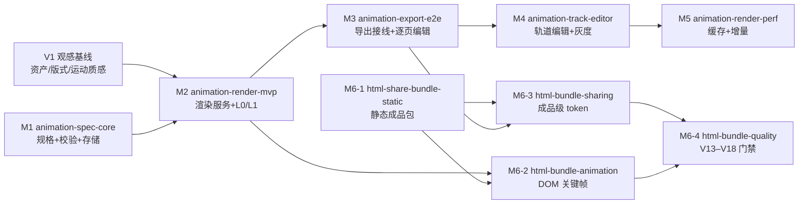

# 动画视频扩展 V1.0 — 交付路线图（OpenSpec 驱动）

> 来源：《动画视频扩展-设计方案-V1_0.md》（`E:/projects/项目设计文档/ppts/`）
> 本文件回答一个问题：**这份设计落到代码仓库后，按什么顺序、拆成哪些变更、每步的验收门禁是什么。**
> 不重复设计正文；只做排序、切分与依赖管理。

## 1. 当前进度

| 变更 | 对应里程碑 | 依赖 | 状态 |
|---|---|---|---|
| `animation-spec-core` ✅ 已归档 | M1 规格与校验 | 无 | 第 1–5 组已完成（规格/校验/存储/迁移/REST 读写）；2026-10-29 归档（`openspec/changes/archive/2026-10-29-animation-spec-core`），能力规格落在 `openspec/specs/animation-spec` |
| `html-share-bundle-static` ✅ 已归档 | M6-1 静态成品包 | 无 | 2026-10-28 归档（`openspec/changes/archive/2026-10-28-html-share-bundle-static`），能力规格落在 `openspec/specs/html-share-bundle`：打包器 + 播放器 + 导出接线 + 隐私模式本地生成（sidecar `export_bundle`）；体积基线 5min/28.55MB（音频占 95.2%） |
| `html-bundle-animation` ✅ 已归档 | M6-2 DOM 关键帧 | `html-share-bundle-static`、`animation-render-mvp` | 2026-10-29 归档（`openspec/changes/archive/2026-10-29-html-bundle-animation`）：清单 v2（底板 + 层图 + 转场 + clips 原样）、播放器按音频时钟回放 WAAPI、页间转场双面板、`shared/motion.ts` 成为两端唯一插值实现（解开渲染侧 2.9）；门禁 `scripts/review/dom-ssim.py` 逐页最差帧 0.99357–0.99818（阈值 0.95）；体积 669KB / 5 页 30 秒，20 页约 2.5MB。**未做**：catalog `targets`/`domFallback`（需产品决策） |
| `html-bundle-sharing` ✅ 已归档 | M6-3 成品分享 | `html-share-bundle-static` | 2026-10-29 归档（`openspec/changes/archive/2026-10-29-html-bundle-sharing`），能力规格落在 `openspec/specs/html-share-distribution`：新表 `artifact_share_links`（锚点 = 成品）、管理端建/列/撤、匿名 `/s/{token}` 入口与条目直出、口令 cookie、CSP、匿名审计。**门禁**「链接内容不随项目编辑变化」抓到真缺陷：`artifacts` 的 upsert 会原地改写 `object_key`，只绑 `artifact_id` 挡不住漂移 → 链接行改为快照 `object_key`/`content_hash`（design ADR-8）。**未做**：`/p/{publicId}` 公开广场接入（需产品先定「成品算不算作品」）、埋点 V18 |
| `html-bundle-quality` ✅ 已归档 | M6-4 质量门禁 | `html-bundle-animation`、`html-bundle-sharing` | 2026-10-30 归档（`openspec/changes/archive/2026-10-30-html-bundle-quality`），能力规格落在 `openspec/specs/html-share-quality`：V14 外链自检（打包时挂在唯一写出口上）、V15 体积构成与预算（3 MiB + 0.55 MiB/分钟）、V16 CDP 可播放性（真实 1x 播放到结尾）、V17 四条降级矩阵。**门禁抓到真实缺陷**：混音轨与逐段音频双份，音频占 80% → 只写混音轨，3.42 → 2.05 MiB（-40%）。**补的实现**：禁 JS 时 noscript 自带逐页图与讲稿、低内存不建动画层。**未做**：V18 埋点、字体子集/WebP/AAC、实测 fps 降级、移动端真机、门禁进 CI 必跑集 |
| `animation-visual-baseline` | §19 批次一（G2/G4/G5） | 无 | 已完成：令牌/10 版式/运动质感/度量 P1–P6/预览生成器；G1 只出契约，G6/G15 归 M2 |
| `animation-render-mvp` ✅ 已归档 | M2 渲染 MVP | `animation-spec-core`、`animation-visual-baseline` | 2026-10-29 归档（`openspec/changes/archive/2026-10-29-animation-render-mvp`），能力规格落在 `openspec/specs/render-plan`（12 条 Requirement）。编译链 + 服务契约 + 客户端 + 镜像（`selftest ok … elapsed=9.42s`）+ 带真实文字的 5 页样片 + 30 页/5 分钟压测 + 单页降级（ADR-24：失败页换静态画面，不再整片失败）全部落地；6.6 真实 deck 已转出到 `animation-render-service-image`（PPTX→页图属上游 L0，渲染器只吃底图 + 元素矩形） |
| `animation-export-e2e` ✅ 已归档 | M3 导出接线 | `animation-render-mvp` | 2026-10-29 归档（`openspec/changes/archive/2026-10-29-animation-export-e2e`），能力规格落在 `openspec/specs/animation-export`（9 条 Requirement）：媒体层拼接与静态段 + 导出接线 + 逐页编辑器 + 单页预览 + 动画开关；4.1–4.5 人工验收全绿（1080p 动画版与静态版时长差 0ms、字幕带 PSNR 65.2/56.1dB、关开关与停服务都拿到静态版并给出 `animationDropped`）。验收中修掉三个「不报错但结果不对」的缺陷：预览预算写死 3s、分段键「页:段」与页内 id 错位、api/worker 两套动画开关判定 |
| `animation-track-editor` 🚧 进行中 | M4 轨道编辑与灰度 | `animation-export-e2e` | **第 1、2、3 段已落地（2026-10-30）**：①能力判定 `animation.AnimationPolicy.Resolve`（优先级 部署闸 > 租户显式 > 租户灰度 > 部署默认）、`animation-rollout` 6 条 Requirement、三处入口共用同一判定、`PPTS_ANIMATION_ROLLOUT`（默认 100，迁移期兼容）与 `SALT`；②动画渲染额度 `animation-quota` 6 条 Requirement：账期编进计量种类（`animation_minutes:YYYY-MM`，跨月是新行且仍单行原子预占）、受理预占/超限 429（带上限-已用-申请量-恢复时间）、按实际渲了动画的页结算（降级页不计费）、失败终态与取消释放（worker 新增 `OnFailed`）、`max_minutes` 未配置为不限量（ADR-7）；③元素级轨道时间轴 `animation-track-editing` 5 条 Requirement：拖动/微调**派生起点**的片段必须同时把 trigger 改写为 `atTime:<ms>`（只改 `startMs` 是「保存成功、成片不变」的假功能，ADR-9）、双端夹紧与页尾截断时长、撤销 24 步且还原时保留当前 `revision`、键盘 10/50ms、受 `capabilities.trackEditor` 控制（未开通只说一句说明，页时长未知时只读）。**剩余**：批量套用（需页列表多选 + N 页写入的失败回滚语义，独立变更）与归档 |
| `animation-render-perf` ✅ 已归档 | M5 渲染性能 | `animation-export-e2e` | 2026-10-30 归档（`openspec/changes/archive/2026-10-30-animation-render-perf`），能力规格落在 `openspec/specs/render-plan`（新增 7 条 Requirement）。片段缓存（键含前一页）+ 增量重渲 + 页级并行 + 性能门禁 `cmd/render-perf`。**实测**：二次渲染 2.4s（判据 ≤10s）、改一页命中 8/10=80%（≥70%，已是 `(n-2)/n` 上限）、30s 正片 P95 4 位 `4×1` 49.3s（≤120s）。**诚实结论**：默认 2 位是 133.9s，达不到 120s，必须显式开页级并行（推荐 `-concurrency 1 -page-concurrency 4`）；默认值留给 M4 按部署形态定。**未做**：S3/MinIO 适配器、缓存后台清理、底图级/成片级缓存（各有实测否决：86ms/页、2.0s） |

两者**无依赖关系，可并行开工**——这是设计 §14 / §20.9 的关键排序结论：先锁规格正确性，同时拿一个「双击可播」的可见成果。

## 2. 依赖图

> 批次一只落了"可编码的那一半"：G2 版式、G4 运动质感、G5 度量。G1 资产体系需要设计资源，本变更只出清单契约（`license` 必填、CC-BY 必须署名）；G6 交互预览与 G15 性能基准必须依附渲染器，随 M2 落地。**M2 的验收因此仍是"5 页样片与参考片并排盲评"**——基线只是把"拿什么评"写清楚了。

## 3. 变更序列（按建议开工顺序）

| # | 变更名 | 里程碑 | 前置 | 核心交付 | 合并门禁 |
|---|---|---|---|---|---|
| 1 | `animation-spec-core`（已建） | M1 | 无 | 模型、catalog、V1–V12、默认规格、Store、读写 API | `go test ./internal/animation/...`；依赖方向断言；`export.go` 零改动 |
| 2 | `html-share-bundle-static`（已建） | M6-1 | 无 | `html_bundle` 产物、manifest、底图转码、IIFE 播放器 | 解压双击可播；外链数 0；生成物与源码一致 |
| 3 | `animation-visual-baseline`（**已完成**） | §19 批次一 | 无（**优先于 M2**） | 设计令牌（栅格/字阶/色板）、10 个版式原型、运动质感档案（stagger/预备/回弹/停顿/速度分层/节拍）、度量 P1–P6、自包含预览页 | 令牌与原型自检 + 32 个用例 + 预览页逐区核对；「5 页样片盲评」移到 M2 验收 |
| 4 | `animation-render-mvp`（**已完成编译链 + 本机出片**） | M2 | #1、#3 | `CompiledTimeline` IR（无动效名，只留属性关键帧）、Spec→IR 编译器、渲染服务（`/v1/render` + `/healthz` + remotion/stub backend）、HTTP 客户端与降级信号 | IR/编译器/服务契约/客户端用例全绿 + 依赖方向断言；本机 Chrome 已出 5×6s=900 帧样片（容器/时长/帧数通过）；**剩余：镜像构建（4.5–4.8）、观感盲评（5.5）** |
| 5 | `animation-export-e2e`（**已建，第 1 组落地**） | M3 | #4 | `export.go` 动画分支与降级、逐页编辑器、导出选项 | 失败必降级为静态版；静态导出回归零失败 |
| 6 | `html-bundle-animation`（**已归档**） | M6-2 | #2、#4 | 清单 v2（挖空底板 + 分层位图 + 转场 + clips 原样）、播放器按音频时钟回放 WAAPI、页间转场双面板、`shared/motion.ts` 两端共用 | 两端同帧 SSIM ≥ 0.95（实测逐页最差 0.99357）；无 WAAPI 与 reduced-motion 降级可用；静态包字节不变。catalog `targets`/`domFallback` 移出范围 |
| 7 | `animation-track-editor`（**进行中**，第 1、2、3 段已落地） | M4 | #5 | 元素级轨道编辑、开关/配额、灰度 | 关闭开关后 0 副作用。**已落地**：①租户级能力判定（部署闸 > 租户显式 > 灰度 > 默认）、SHA-256 分桶、三处入口共用判定、`PPTS_ANIMATION_ROLLOUT`/`SALT`，用例覆盖显式 true 绕过 0% 灰度、显式 false 压过 100%、`policy_unreadable` fail closed、写 404/读 200；②渲染分钟额度：受理预占（30 并发上限 10 每单 4 → 只成功 2 单，不超卖）、超限 429 且不建任务、降级页不计费、整体退回静态结算 0、失败终态与取消释放、改上限下一次导出即生效；**迁移决策**：`max_minutes` 未配置为不限量（与 ADR-3 同一条理由：升级当天不给存量租户加硬停）；③元素级轨道时间轴：拖动/微调**派生起点**的片段改写 trigger 为 `atTime:<ms>`（用例守「只改 `startMs` 是保存成功、成片不变」）、双端夹紧、页尾截断时长、撤销 24 步保留 `revision`、键盘 10/50ms，`animation-check` 26/26。**剩余**：批量套用（多选 + N 页写入回滚语义，独立变更）与归档 |
| 8 | `html-bundle-sharing`（**已归档**） | M6-3 | #2、#5 | 新表 `artifact_share_links`（绑成品 + 快照 `object_key`）、管理端建/列/撤、匿名 `/s/{token}` 条目直出、口令 cookie、CSP、匿名审计 | 链接内容不随项目编辑变化（锚点用例：重新导出后旧 token 逐字节相同）；撤销即时生效；路径穿越全部 404。`/p/{publicId}` 公开广场接入移出范围（需产品决策） |
| 9 | `animation-render-perf`（**已归档**） | M5 | #7 | 片段缓存（键含前一页）、增量重渲（`--only-pages`）、页级并行（`--page-concurrency`）、性能门禁 `cmd/render-perf`；三级缓存中的底图层与成片层经实测否决 | 二次渲染 **2.4s**（判据 ≤10s）；改一页命中 **8/10=80%**（≥70%，`(n-2)/n` 上限）；30s 正片 P95 **49.3s**（≤120s，需 4 位）。逐页 SHA-256 四方一致（冷渲/关缓存/命中/增量）。**默认 2 位为 133.9s 不达标**，达标配置写进 `deploy/renderer/README.md` |
| 10 | `html-bundle-quality`（**已归档**） | M6-4 | #6、#8 | V14 外链自检、V15 体积构成与预算、V16 CDP 可播放性、V17 四条降级矩阵、禁 JS 可读、低内存降级、音频去重 | V13–V17 可一条命令跑完（`scripts/review/bundle-gate.py`）；实测 21 条判据全 PASS，2.05 MiB / 预算 3.28 MiB；反例删层图即红。V18 埋点与字体子集/WebP/AAC 移出范围（需产品与资产决策） |
| 11 | `animation-vector-redraw`（条件触发） | P3 / L3 | 触发指标达成 | 解析器样式字段 + `vector-text` | 标题可打字机/逐字高亮 |

## 4. 门禁定义（每个变更都必须自带）

| 门禁 | 内容 |
|---|---|
| 构建 | Go：`go build ./... && go vet ./...`；前端（如涉及）：`npx tsc --noEmit` + `npm run build` |
| 测试 | `go test ./... -race`；新增包覆盖率不低于仓库同层平均水平 |
| 依赖纪律 | `go.mod` / `package.json` 无未经说明的新增依赖（设计附录 F 清单之外一律拒绝） |
| 回归 | 静态导出、讲稿、时间轴行为不变；涉及 `export.go` 的变更必须带表驱动测试 + 关闭开关下的等价用例 |
| 降级 | 任一新增能力故障都不得让用户拿不到视频（动画通道失败 → 静态版） |
| 文档 | 变更归档时同步 `openspec/specs/`，并把实际落地与设计偏差回写到方案文档 |

## 5. 未决决策（必须先定，再建对应变更）

| 编号 | 决策 | 影响变更 | 建议 |
|---|---|---|---|
| Q1 | 首版是否提供「全片预览」 | #5 `animation-export-e2e` | 先只做单页预览（成本可控），全片预览按配额开放 |
| Q2 | 免费层是否允许动画导出 | #7 `animation-track-editor` | 允许，但配额收紧（获客优先于短期成本） |
| Q3 | 竖屏比例是否进首版 | #4 `animation-render-mvp` | 不进；`RenderPlan` 已含宽高，留扩展位 |
| Q4 | 是否投入 Lottie 精修通道 | #3 `animation-visual-baseline` | 取决于是否有设计资源，先不做 |
| Q5 | HTML 成品默认形态（单文件/目录） | #2、#10 | 目录形态为默认，单文件作为「≤8MB 附赠」 |
| Q6 | 是否开放文本复制 | #8 `html-bundle-sharing` | 租户级开关，默认关闭 |

## 6. OpenSpec 工作流约定

- **一个里程碑一个变更**：变更名用能力语义（`animation-render-mvp`），不用「实现某某」。
- **能力路径稳定**：`animation-spec`、`html-share-bundle` 已建立；后续沿用同一路径追加 requirement，不新建近似能力。
- **归档动作**：变更任务全绿 → `openspec archive <name>` → 主 spec 吸收 delta；不手工编辑 `openspec/specs/`。
- **提交纪律**：一个变更 = 一个 commit（必要时按 PR1/PR2 拆分），提交信息带变更名与里程碑号。

## 7. 浏览器侧验收补记（M3 之后）

4.1–4.5 是脚本驱动的：请求路径、断言都由脚本写死，因此「UI 自己拼的路径对不对」
不在覆盖范围里。补一次浏览器验收（headless Chrome + CDP，1440×1000）后暴露两件事：

| 现象 | 根因 | 处置 |
|---|---|---|
| 点「创建导出任务」立刻 `HTTP 404` | `createArtifactExport` 发 `/projects/{id}/exports`，后端注册的是 `/api/projects/{projectId}/exports`。POST 没有 SPA 兜底（SPA 只兜 GET），故是硬 404：**从 UI 导出 MP4 / HTML 成品包一直失败**（自 M6-1 起） | 前端补前缀；同 bug 的 `createHTMLBundleExport` 已无人调用，直接删除；`api-contract-check` 增加「前端 REST 路径必须在 Go 路由表里」的不变量（Go `{param}` 与 `${...}` 都归一成 `*`） |
| 降级后「没有任何提示」 | 提示 `form-warn` 渲染在对话框底部，而对话框常高于视口 —— DOM 里有、屏幕上没有 | 出现时 `scrollIntoView({ block: 'center' })`；验收断言从「元素存在」改为「矩形在视口内」（`warnVisible`） |

复现这套时序（要造降级，必须让「选项已拿到可用」与「导出时不可用」分离）：

1. 渲染服务健康时打开导出对话框 → 选 MP4 → 勾「动画视频」（此时选项为 `1/3 页配了动效`）
2. 停渲染容器，等 >10s（`defaultProbeTTL`；失败也缓存，免得每次请求都打过去）
3. 点「创建导出任务」→ 编辑器：对话框不关、琥珀色提示在原位；列表页：对话框关闭、`.floating-notice.warn`

两处的任务都 `JOB_STATE_SUCCEEDED`，服务端日志可见 `POST /api/projects/{id}/exports 201` ——
「降级不等于失败」这句话在界面上才是成立的。
